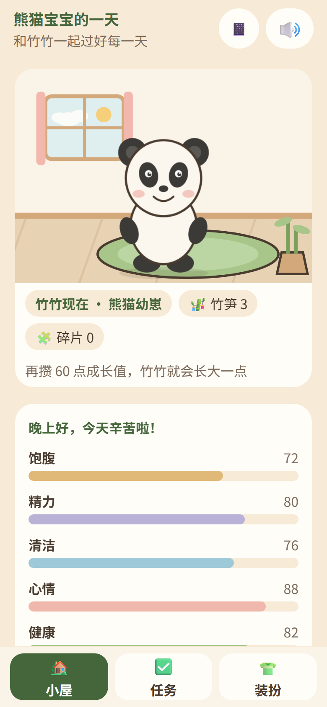
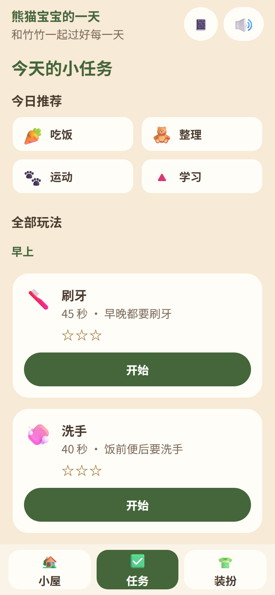
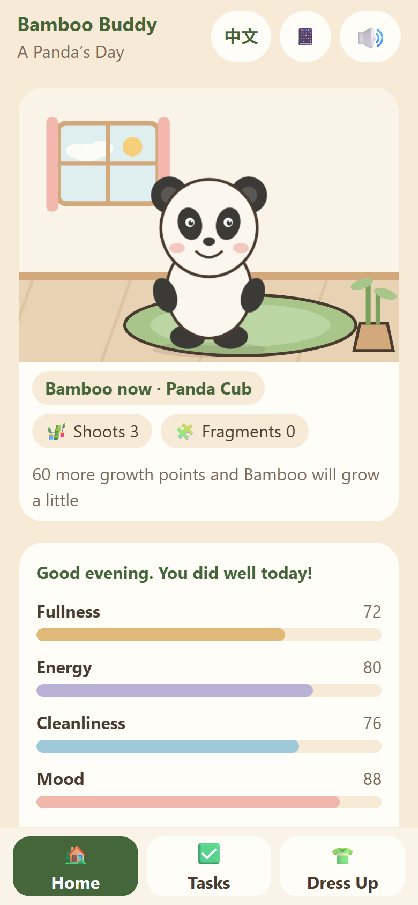
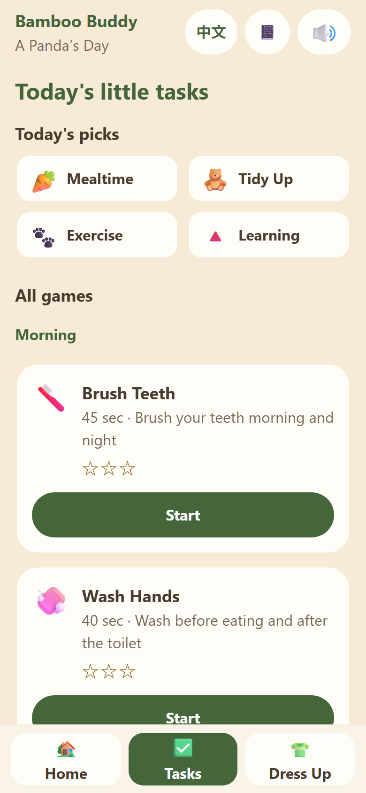
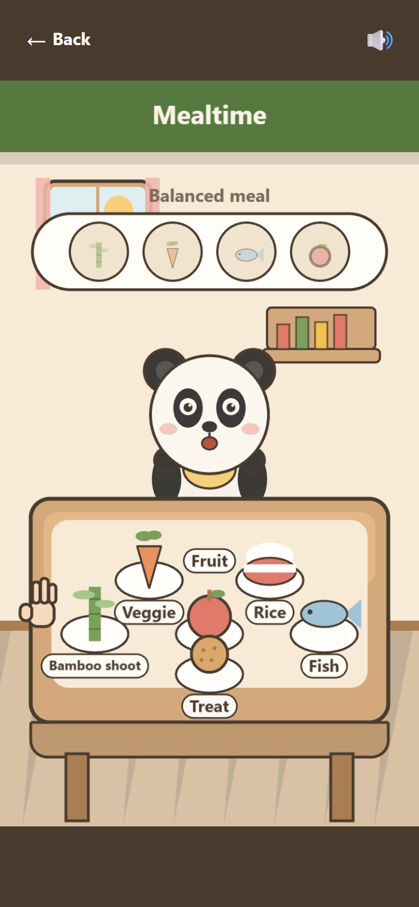
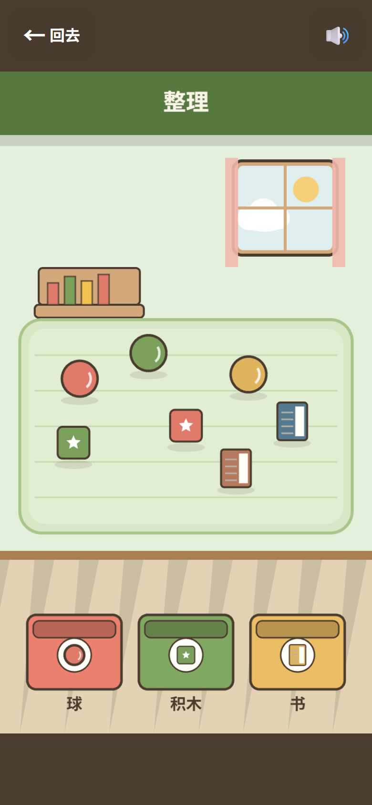
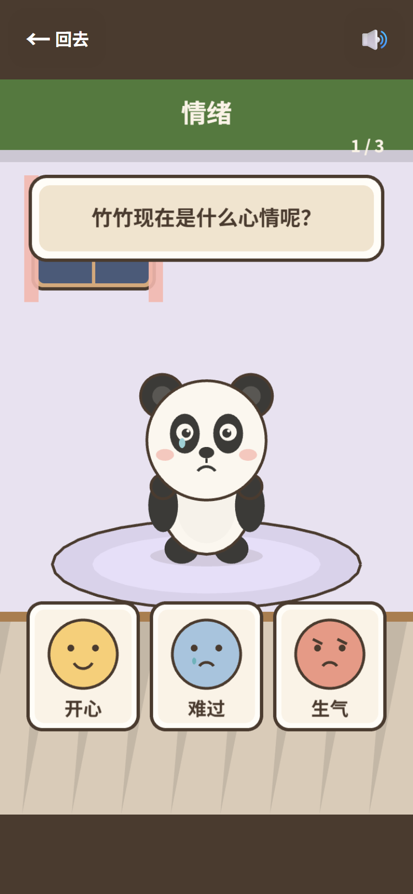

# 熊猫宝宝的一天 · Bamboo Buddy

> 面向 4–8 岁儿童的轻量日常生活养成游戏，中英文双语。孩子照顾卡通大熊猫「竹竹 / Bamboo」，在吃饭、刷牙、洗手、穿衣、洗澡、睡觉、整理、运动、情绪、学习中完成一件件小事，竹竹因此开心长大。
>
> 英文名 **Bamboo Buddy**，副标题 **A Panda’s Day**，熊猫角色名 **Bamboo**（中文仍叫「竹竹」）。

技术选型参考同目录的 CHAGS（中国历史典故游戏合集）：**H5 优先、Phaser 4 + Vue 3.5 双栈、pnpm workspace、内容 JSON + zod、纯逻辑与渲染分离、本地优先、一条命令验收**。本仓库是这套选型在「儿童日常养成」场景下的完整落地。

### 界面一览（程序化绘制，无位图资源）

| 小屋（中文） | 任务（中文） | 刷牙（中文） |
|---|---|---|
|  |  |  |

| Home (English) | Tasks (English) | Mealtime (English) |
|---|---|---|
|  |  |  |

| 整理 | 情绪 | |
|---|---|---|
|  |  | |

---

## 1. 快速开始

```bash
pnpm install
pnpm dev          # http://127.0.0.1:5190
pnpm build        # 产物 apps/site/dist
pnpm preview      # http://127.0.0.1:5191
```

验收（提交前必须全绿）：

```bash
pnpm verify       # typecheck → lint → test → content:check → build → size
pnpm e2e          # Playwright：10 个玩法 autoplay 全通关 + 真实操作 + 家长页
```

---

## 2. 产品范围（对应《熊猫宝宝的一天》方案）

### 核心循环

1. 打开小屋，看到竹竹与五维状态（饱腹 / 精力 / 清洁 / 心情 / 健康）；
2. 按现实时间段推荐 4 件今日小事（早上 / 中午 / 晚上）；
3. 进入 30–90 秒小游戏：刷牙、洗手、吃饭、穿衣、洗澡、睡觉、整理、运动、情绪、学习；
4. 完成后得到竹笋、星星、装扮碎片，偶尔得到贴纸；
5. 用竹笋 / 碎片解锁衣服与小窝物件，喂竹笋给竹竹；
6. 竹竹积累成长值，经历四个成长阶段，到第四个阶段解锁「竹竹的小屋」与旅行日记。

### 已实现的系统

| 系统 | 落点 | 说明 |
|---|---|---|
| 日常任务 | `packages/progress/src/daily.ts` | 日期 + 时段做种子，确定性推荐 4 件；三个时段各有 2 件以上可选内容 |
| 五维状态 | `packages/progress/src/stats.ts` | 跨天轻衰减、只增不减的任务收益、低于 40 只给一句温柔提示；永不归零、无死亡、无惩罚 |
| 奖励 | `packages/progress/src/rewards.ts` | 竹笋 / 星星 / 装扮碎片；当天重复玩奖励减半但仍有收益；每完成第 3 件不同任务得一枚碎片 |
| 成长 | `packages/progress/src/growth.ts` | 四个阶段：熊猫幼崽 → 小熊猫 → 大熊猫 → 竹竹的小屋（300 成长值） |
| 连续天数与贴纸 | `rewards.ts` + `manager.ts` | 同一任务连续 3 天完成得一张贴纸；断签不清数据、不提示"你断了" |
| 亲密度 | `packages/progress/src/intimacy.ts` | 摸头 / 抱抱 / 击掌每天各一次，喂竹笋不限次（消耗奖励）；五档亲密度解锁小动作 |
| 装扮与小窝 | `packages/progress/src/catalog.ts` | 12 件衣服 + 7 件小窝物件，全部用玩出来的竹笋 / 碎片解锁；无抽卡、无内购 |
| 日记与图鉴 | `diary.ts` + `apps/site/src/views/DiaryView.vue` | 自动生成「竹竹的一天」：图标 + 语音回顾；七个最近日子 + 贴纸册 |
| 家长页 | `views/ParentView.vue` | 安全边界、最近七天记录、本周练习过的习惯、声音开关、长按清档 |
| 情感设计 | 全局 | 竹竹叫玩家「小伙伴」；做对鼓掌冒星星；做错只说"再试一次"，无失败音效；每天固定的亲近动作 |
| 中英文双语 | `packages/i18n` + `packages/content/src/i18n/en` | 界面文案、任务标题/习惯/日记、玩法语音与关卡文案全部双语；`?lang=en` 或头部语言按钮切换，选择记在 `localStorage`；英文文案是懒加载 chunk，中文用户不下载 |

### 十个玩法与八个模板

内容里的一条任务声明它的模板，模板只提供交互原语，关卡数据决定这一局的画面与目标：

| 模板 | 交互原语 | 用于 |
|---|---|---|
| `scrub` | 按住工具来回刷，刷掉点点，再冲水 / 擦干 | 刷牙、洗手、洗澡 |
| `feed` | 把食物拖到嘴边，一口一口吃完 | 吃饭 |
| `dress` | 把衣物拖到身上正确的部位 | 穿衣 |
| `order` | 按顺序完成睡前步骤，点错不清进度 | 睡觉 |
| `tidy` | 按类别把玩具拖进对应的箱子 | 整理 |
| `rhythm` | 墙钟驱动的开合节奏，看准窗口点按 | 运动 |
| `pick` | 认情绪 + 安慰动作 | 情绪 |
| `learn` | 颜色 / 形状 / 数字点选 | 学习 |

「逻辑与渲染分离」是硬规矩：每个模板有一份不 import Phaser 的 `*.logic.ts`（关卡 schema + 判定函数），场景只负责画与把手势喂进判定。判定、奖励、连续天数都能脱离浏览器单测。

---

## 3. 技术选型

| 决策项 | 选型 | 理由 |
|---|---|---|
| 游戏引擎 | **Phaser 4.2.1**（TypeScript 一等公民，MIT） | 纯代码、可 diff、可单测；只出现在 `games/*` 与 `packages/phaser-kit`，外壳首屏不付引擎体积 |
| 应用外壳 | **Vue 3.5 SFC + Pinia + Tailwind 4** | 小屋 / 任务 / 装扮 / 日记是 UI 密集型，SFC 改一个页面只动一个文件；状态集中在 Pinia |
| 语言 | **TypeScript 5.9.3 strict** | 与 vue-tsc 兼容（CHAGS 实测 TS 7 会崩，这里沿用同一基线） |
| 构建 | **Vite 8 + pnpm workspace** | 每个玩法自动独立 chunk；Phaser 单独成 chunk、只在进游戏时加载 |
| 内容 | **JSON + zod，构建期校验** | 换一条任务 = 换内容，不写代码；`pnpm content:check` 在 CI 拦错 |
| 存储 | **IndexedDB（本地优先）+ 可替换接口** | 无后端、无账号、不采集儿童信息；存档只在本机 |
| 音频 | **WebAudio 合成 + 浏览器 TTS** | 零音频文件先把"听"通道跑通；换成真人配音只改 `platform` 一个实现 |
| 测试 | **Vitest + vue-tsc + Playwright + 内容校验 + 体积门禁** | `pnpm verify` 一条命令全绿才算完成 |
| 后端 | **无** | 纯静态站点；家长报告只基于本机记录 |

### 三条架构铁律

1. **逻辑与渲染分离**：规则写在 `*.logic.ts` 与 `packages/progress`，不 import Phaser，可脱离浏览器单测。
2. **游戏不直接碰环境**：存储、音频、生命周期一律通过注入的 `PlatformServices`；游戏代码里没有 `localStorage` / `fetch` / `IndexedDB`。
3. **每个玩法都能被无头直达**：`#/play/<id>?autoplay=1` 自动通关、`?instant=1` 跳过过场，端到端测试因此不靠"运气点得准"。

---

## 4. 仓库结构

```text
BambooBuddy/
├─ apps/site/                 # Vue 3.5 外壳（小屋 / 任务 / 装扮 / 日记 / 家长 / 游戏宿主）
├─ packages/
│  ├─ game-kit/               # GameModule / GameContext / 事件 / 存档类型（无 Phaser）
│  ├─ content/                # 10 条任务的摘要 JSON + 详情 JSON + loadTask() 动态加载
│  ├─ i18n/                   # 中文界面文案表（键是联合类型，写错编译期报）
│  ├─ progress/               # 纯 TS：任务推荐、状态衰减、奖励、成长、连续天数、亲密度、贴纸、存档迁移
│  ├─ platform/               # Web 实现：IndexedDB / 合成音效 / TTS / 生命周期 / 本地 telemetry
│  ├─ phaser-kit/             # 主题、卡通绘制、竹竹与道具、拖拽、BaseScene、Phaser 裁剪版
│  └─ templates/              # 8 个玩法模板：*.logic.ts（判定）+ *.ts（场景）+ 关卡 schema
├─ games/daily/               # 10 个玩法的入口（一个任务 = 一个动态 import 的子路径）
├─ e2e/                       # Playwright：冒烟、真实操作、家长页、生产产物懒加载
├─ scripts/                   # verify 执行器与体积门禁
└─ docs/技术方案.md            # 更完整的架构决策与踩坑记录
```

### 内容拆两半

和 CHAGS 的 `content` / `content-full` 同一条教训：小屋 / 任务 / 装扮 / 日记只需要摘要（标题、emoji、时段、收益、日记一行），关卡脚本与语音文案只有进入玩法才需要。

- `packages/content/src/tasks/<id>.json`：摘要，静态加载；
- `packages/content/src/details/<id>.game.json`：详情（intro / done / retry / levelScript），`loadTask()` 动态 import；
- 外壳 eslint 禁止 `@bamboo/content/full`：一句 import 就能让懒加载作废，而体积门禁要到打包后才发现，所以在写的当下就拦住。

### 一个玩法的最小实现

```ts
// games/daily/src/games/brush.ts
import { getTaskSummary } from '@bamboo/content';
import { defineGame } from '@bamboo/templates/core';
import { createScrubScene } from '@bamboo/templates/scrub';
import type { ScrubLevel } from '@bamboo/templates/scrub.logic';

const summary = getTaskSummary('brush')!;

export default defineGame({
  manifest: {
    id: 'brush', title: summary.title, version: '0.1.0', template: summary.template,
    designSize: { width: 750, height: 1334 }, ageRange: summary.ageRange,
  },
  scenes: (ctx) => [createScrubScene(ctx, ctx.task.levelScript as ScrubLevel)],
});
```

新增一条任务：加两份 JSON → 在 `tasks.ts` / `loadTask.ts` 登记 → 选一个模板（或新写一个模板）→ 加一行 `registry.ts` 动态 import。新增一个模板：在 `content/ids.ts` 的 `TEMPLATE_IDS` 加 id → 写 `<id>.logic.ts` 的 zod schema + 判定 → 写场景 → 在 `templates/schemas.ts` 登记。少登记任何一处，typecheck / content:check 会当场报。

---

## 5. 儿童向交互与安全规范（写进 code review）

- 可点击区域 ≥ 88×88 逻辑像素；按钮不依赖 hover。
- **无失败惩罚、无倒计时、无扣命**；错了只是"再试一次"，星星最低 1 颗。
- 全部关键文本配中文语音引导；屏幕文字尽量少，按钮有图标。
- 不靠颜色单独传达信息（整理箱子用形状 + 图标区分，色盲友好）。
- 声音总开关（小屋 / 游戏内 / 家长页同一状态，localStorage 记忆）；静音时语音立即停止。
- 尊重 `prefers-reduced-motion`；20 分钟休息提醒一天一次。
- **家长锁**：长按标题 3 秒进入家长页；清除存档需要长按 3 秒。
- 无广告、无内购、无抽卡、无社交、不采集儿童个人信息。

---

## 6. 体积预算（`pnpm size` 守卫）

| 预算项 | 上限 |
|---|---|
| 首屏 JS + CSS（gzip） | ≤ 60 KB（不含 Phaser；实测 54.4 KB，原始 160.2 KB） |
| 单个懒加载 js/css（gzip） | ≤ 260 KB（Phaser 裁剪版实测 220.6 KB / 856.3 KB 原始） |
| dist 原始大小 | ≤ 2400 KB（实测 1197 KB） |
| 单个非代码资源 | ≤ 200 KB |
| 非代码资源合计 | ≤ 600 KB（当前是 0：全部几何绘制 + WebAudio 合成） |

> 具体数字以 `pnpm size` 的输出为准；以上为 2026-10-19 的实测基线。

### 最近一次验收

- `pnpm verify`：typecheck / lint / **86 个单测** / content:check（中英各 10 条 + 关卡脚本 + 零漏翻）/ build / size 全绿。
- `pnpm e2e`：**20 passed / 2 skipped / 0 failed**（skipped 是 preview 用例在 dev 配置下的预期跳过）——10 个玩法 autoplay 全通关、刷牙/整理/睡觉三条真实指针链路、家长锁与清档、刷新后进度保留、中英文切换与英文玩法。
- `pnpm e2e:dist`：生产产物 **2 passed**——首屏不下载任何重 chunk、10 个玩法各自懒加载、Phaser 只在首个玩法时加载。

---

## 7. 与 CHAGS 的异同

**沿用**：Phaser 4 + Vue 3.5 双栈、workspace 分包、内容 JSON + zod、GameModule/GameContext 契约、逻辑与渲染分离、调试开关（autoplay / instant）、体积门禁、无后端、本地优先、儿童安全规范。

**有意的差异**：本作是日常习惯养成，不要求"听完故事才能玩"——语音引导播放的同时就可以动手（4–8 岁的日常模仿需要即时反馈）；没有间隔重复复习（核心指标是"今天把好习惯做了一遍"）。双语是本轮补上的能力：界面、内容、语音三层一起切，游戏代码不知道语言的存在。

**主动不做**：

- 到期复习 / 间隔重复；
- 账号、云存档、排行榜、多人、内购、广告、CMS、PWA（后续可按 `PlatformServices` 路径逐项加）；
- 抽卡 / 限定皮肤（装扮全部由游戏内奖励解锁）。

---

## 8. 已知限制

- 语音使用浏览器 / WebView 的 `SpeechSynthesis`；按语言挑嗓音（zh-CN / en-US），无语音包或静音时游戏照常可玩，只是没有旁白。
- 存档在 IndexedDB；无痕模式或存储被清理后会回到初始状态（外壳会提示"这次可能没存上"）。
- 美术全部为程序化几何绘制与 SVG，没有位图角色；风格统一但细节有限。
- 家长页只展示本机记录，不含跨设备统计。

---

## 9. 文档

- [技术方案](docs/技术方案.md)：架构决策、契约、模板列表、存档结构、测试与门禁、踩坑记录。
- 体验入口：`pnpm dev` 后打开 http://127.0.0.1:5190，建议用手机尺寸（DevTools 375×812 或 430×932）。